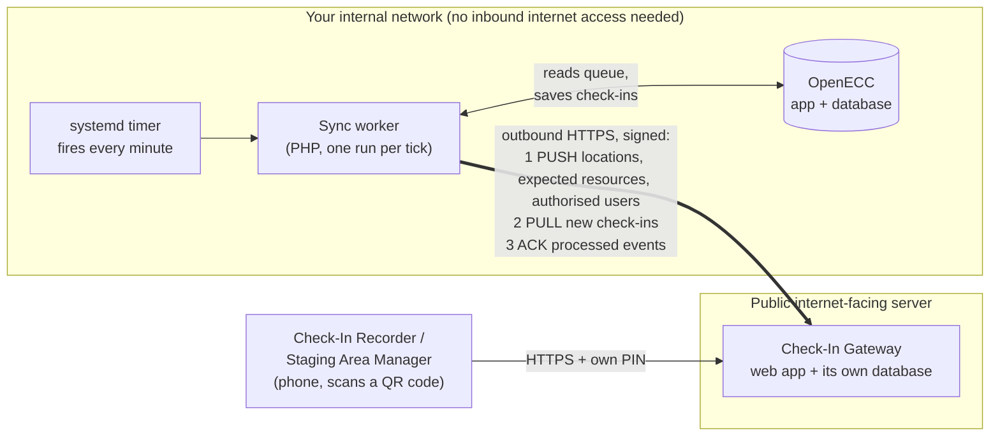

# OpenECC

> **Command Bridge is now OpenECC.** The project was renamed in November 2026 (0.9.0-beta.5) because other
> emergency-management products use the name "Command Bridge". Folders, services and the database have new names too,
> so an old Command Bridge install can't be updated in place: back it up, install OpenECC fresh and restore. See
> [openecc/docs/MIGRATING.md](openecc/docs/MIGRATING.md).

OpenECC is free, self-hosted software for an **Emergency Coordination Centre (ECC)**. It supports incident
documentation, resource coordination, finance and administration tracking, and incident records, using
**ICS-compatible** forms and positions so the ECC's records line up with the Incident Command Post (ICP) and Incident
Management Team (IMT) it supports. It is built on PHP 8, MariaDB and Apache and installs on a plain Debian server inside
your network.

> **Free software, with no warranty.** OpenECC is free software: you may use, copy, change and share it under
> the terms of the [GNU Affero General Public License v3.0](LICENSE.txt) (AGPL-3.0). It is provided **as is, without
> any warranty**. We don't promise that it works correctly, that it is free of errors, or that it is suitable for any
> particular purpose, including emergency management. You use it at your own risk. As far as the law allows, the
> authors and contributors are not liable for any loss or harm that comes from using it.
>
> Before you rely on it in a real emergency, test it and make sure it does what your organization needs, and keep a
> way of working without it, such as paper forms. The full terms, including the disclaimer of warranty and limitation
> of liability (sections 15 and 16), are in [LICENSE.txt](LICENSE.txt).

# Public Demo
We have put up a public demo page at https://demo.openecc.ca.  This has a fictional incident in progress.  You can do just about everything except change system settings.  The main page lists the ECC positions you can log in as, including the ECC's Incident Commander.  The data gets reset every 60 minutes.  All of the data in this sample incident has been randomly generated and is for testing and demonstration purposes.  There is still a long way to go to finish this project but I think this is a good starting point.

> **Public beta - version 0.9.0-beta.5 (OpenECC; Check-In Gateway 0.9.0-beta.3).** It is used operationally but has not had wide testing. Test your install,
> keep backups, and read [SECURITY.md](SECURITY.md) before putting real incident data in it.

## What OpenECC is (and is not)

* **It is** an internally hosted ECC support system: incidents and operational periods, the ECC organization, ICS Canada
  forms with sign-off and PDF export, resources, facilities and staging, finance and administration, and an ECC display.
* **It is not** the field operating environment for an on-scene IMT or ICP, and it does not replace one. It keeps the
  ECC's records in ICS-compatible form and works alongside whatever the IMT uses in the field.
* **The ECC uses the ICS organization for its own staff.** Many ECCs in Canada are organized with ICS positions, and
  the person in charge of the ECC is often the Director of Emergency Management acting as Incident Commander. In
  OpenECC, the Incident Commander, Section Chiefs and other positions are the **ECC's** staff. They are not the
  on-scene IC or the field IMT, who keep their own command structure and their own records. The ICS forms in Command
  Bridge are the ECC's records, kept in ICS-compatible form so they line up with the ICP's.
* **Positions:** the standard ICS positions come from a controlled catalogue. An ECC can also add its own support roles
  (for example GIS, IT or a municipal liaison). Those are ECC roles, not ICS command positions, unless they genuinely
  map to one.
* **Connectivity:** OpenECC does not need the internet. It keeps working on the ECC network during an internet
  outage. It does need its own server and the ECC network: it is a web application, not an offline program on each
  workstation. Plan for that with a UPS, a spare server or laptop, tested backups and restore media, and a paper
  fallback using blank ICS forms.
* **External check-in** is a separate, deliberately limited gateway (below). It is not a remote copy of OpenECC
  or a field IMT system.

## Two programs, two servers

This repository contains two programs that work together:

| Folder | What it is | Where it runs |
|---|---|---|
| [`openecc/`](openecc/) | The main ECC application: users, incidents, ICS forms, resources, ECC display, admin. | **Inside your network.** Does not need to be reachable from the internet. |
| [`checkin-gateway/`](checkin-gateway/) | A small, limited check-in service where Check-In Recorders and Staging Area Managers record arriving resources from a phone (via a QR code or link). Nothing else. | **On a publicly reachable server** (internet-facing, HTTPS). |

You can run OpenECC on its own. The gateway is optional and is only needed when people **outside** your network
must check resources in.

### Why two servers?

Responders in the field cannot reach an internal server, and you should not expose your incident database to the
internet to let them. The gateway solves this: it sits on the public side with its **own separate database**, holds only
the small amount of information needed for check-in, and never connects to OpenECC's database. OpenECC
reaches *out* to the gateway; the gateway never reaches *in*.

If the internet connection drops, OpenECC keeps working inside the ECC. Check-ins recorded on the gateway wait
there and are picked up when the connection returns.

## How they work together



The thick arrow always starts inside your network and points out. No inbound connection from the internet to OpenECC is needed.

### The timer that polls the gateway

OpenECC installs a systemd timer, `openecc-external-checkin-sync.timer`, that fires **once a minute** and runs
a one-shot worker (`openecc/app/bin/external_checkin_sync_worker.php`). Each run:

1. **Pushes** anything that changed since last time to the gateway: active check-in locations, the *expected resources* for
   each location, and which Check-In Recorder / Staging Area Manager PINs (as bcrypt verifiers, never plain PINs) are authorised where.
2. **Pulls** check-ins and exception events that people have recorded on the gateway since the last poll.
3. **Acknowledges** each event it processed. Until it is acknowledged the gateway keeps it and offers it again, so a
   network outage or a restart loses nothing; the worker retries with back-off.

Processed check-ins update the Resources Unit record and the linked ICS 211 (personnel) or ICS 218 (vehicles and equipment) entry.
Every request is signed with a shared secret (HMAC-SHA256) and has a time limit, so the gateway ignores anything that is
not from your OpenECC. The **Sync status** page in OpenECC shows what is queued, delivered or failed, and lets
an administrator retry stuck items.

The timer is installed by the OpenECC installer but only switched on once a connection test to the gateway passes
(see *Connect them* below). Both servers need accurate clocks: signed requests more than 5 minutes off are refused.

### What the gateway knows (and does not)

* It receives only: location names/addresses, the expected resources for check-in (reference number, provider, type), and for
  each authorised recorder a display name, role, allowed locations and a PIN *verifier*.
* It never receives incident forms, other users, your incident database or any plain-text PIN.
* Failed PIN attempts are throttled (per address, per repeat offender, per location), with an admin tool to review and clear blocks.

## Getting started

Do you need check-in from outside your network? If not, install only OpenECC.

1. **OpenECC** (internal Debian 12/13 server, root access):
   ```bash
   cd openecc
   sudo ./install.sh
   ```
   Guided installer: packages, database, Apache, HTTPS (self-signed by default for internal servers), first administrator.
   See [openecc/docs/INSTALL.md](openecc/docs/INSTALL.md).
2. **Check-In Gateway** (separate, publicly reachable Debian 12/13 server with a DNS name such as `checkin.example.ca`):
   ```bash
   cd checkin-gateway
   sudo ./install.sh
   ```
   It asks for its address, HTTPS (Let's Encrypt recommended; OpenECC needs a gateway certificate it trusts) and a
   shared secret. See [checkin-gateway/docs/INSTALL.md](checkin-gateway/docs/INSTALL.md).
3. **Connect them:** either answer *Yes* to the Check-In Gateway question in OpenECC's installer, or run
   `sudo /var/www/openecc/tools/setup_checkin.sh` later. Whichever server you set up first generates the key ID and
   secret; you paste them into the other. The script tests the connection and switches the timer on when it passes.
   Details, including changing the secret later: [openecc/docs/EXTERNAL_CHECKIN.md](openecc/docs/EXTERNAL_CHECKIN.md).
4. Run the built-in self-check on OpenECC ([openecc/docs/SMOKE_TEST.md](openecc/docs/SMOKE_TEST.md)).

Both installers use friendly `whiptail` dialogs on a terminal and plain prompts otherwise; both log to `/var/log/`.

## Requirements

* Debian 12 or 13 on each server (the installers install everything else), about 1 GB RAM for OpenECC, less for the gateway.
* OpenECC: outbound HTTPS to the gateway only if you use check-in.
* Gateway: ports 80 and 443 reachable from the internet (Let's Encrypt needs both), and a DNS name.

## Repository layout

```
OpenECC/
├── openecc/   main ECC application  (install.sh, update.sh, app/, database/, docs/, deploy/)
├── checkin-gateway/  public check-in gateway (install.sh, update.sh, public/, app/, database/, docs/, deploy/)
├── LICENSE.txt       GNU AGPL-3.0
├── SECURITY.md
└── README.md         (this file)
```

Each folder is self-contained: its own `VERSION`, `CHANGELOG.md`, installer, updater and numbered database migrations.
Release notes: [openecc/CHANGELOG.md](openecc/CHANGELOG.md), [checkin-gateway/CHANGELOG.md](checkin-gateway/CHANGELOG.md).
Keep both servers on the same release when upgrading.

## Based on ICS Canada

OpenECC follows the Incident Command System as used in Canada and published by
[ICS Canada](https://icscanada.ca/). Its forms are the approved ICS Canada forms, available from the
[ICS Canada forms page](https://icscanada.ca/resources/ics-forms/). OpenECC is an independent project and is not
made or endorsed by ICS Canada.

ICS Canada's [ICS Forms Catalogue (2022)](https://icscanada.ca/wp-content/uploads/2023/07/ICS-Canada-Forms-Catalogue-2022_v1.pdf)
explains the purpose of each form, who prepares it, who it goes to and what goes in each block. It is a good companion
to the in-app help.

### Official forms

OpenECC fills the ICS Canada form templates in `openecc/app/assets/pdf/official/`. **We do not yet have
permission from ICS Canada to use or redistribute these forms.** We hope to have it soon. Until then, the
forms remain the property of ICS Canada, and the AGPL does not cover them. If you are from ICS Canada and have concerns,
please open an issue on this repository or email me directly at stephen@thebitbucket.ca. See [openecc/docs/FORMS.md](openecc/docs/FORMS.md) and
[openecc/THIRD_PARTY.md](openecc/THIRD_PARTY.md).

## Licence

Both programs are free software under the **GNU Affero General Public License v3.0** ([LICENSE.txt](LICENSE.txt)). If you run a
modified version for users over a network, you must offer them the corresponding source; each program's footer links to this
repository for that purpose. Both come with **no warranty** (see the notice at the top of this file).
